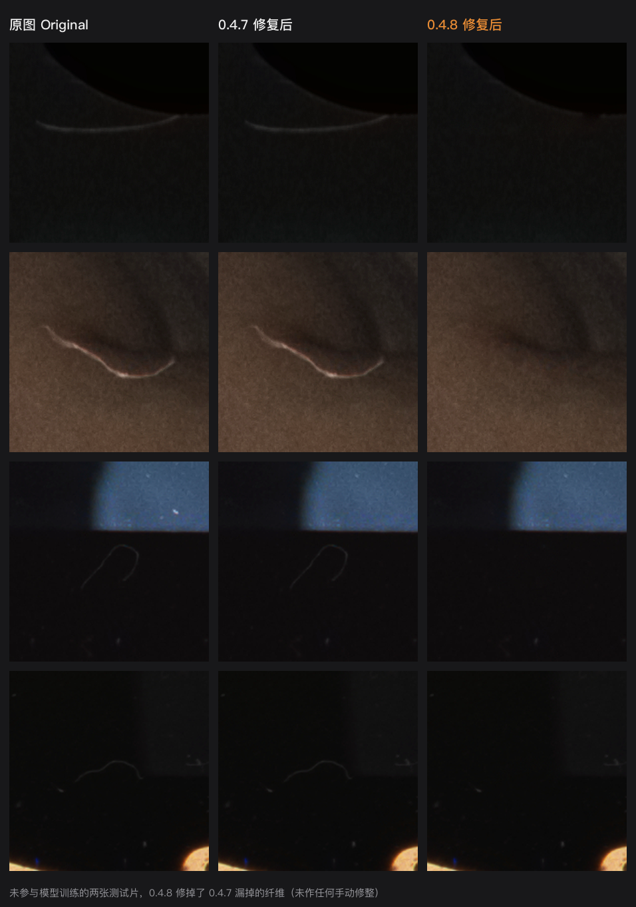
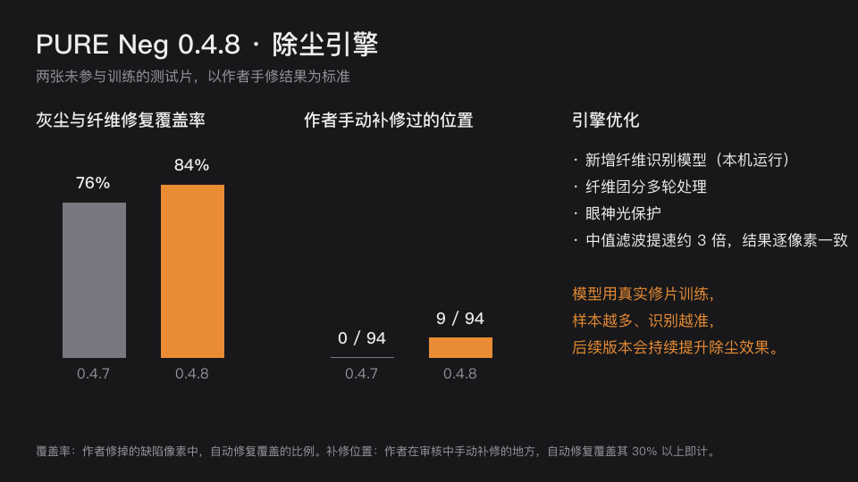

# PURE Neg 更新说明

## 0.4.8

这一版主要让毛发、纤维认得更准，修整和导出更顺手。

上面两张图来自两张**没有参与模型训练**的测试片，以作者手修的结果为标准，0.4.8 的自动结果未做任何手动修整。

**纤维识别模型会持续训练。** 它用真实修片学习，每增加一批修好的片子就能重新训练一次。后续版本会用更多不同胶卷、不同场景的样本继续提升除尘效果。

### 识别更准
- **新增纤维识别模型。** 用真实修片训练的小模型，在本机运行，不联网。以前漏掉的淡纤维、彩色背景上的纤维、颗粒较粗的片子上的纤维，现在能找到更多。模型只负责提示"这里像纤维"，修不修仍由原有规则把关，不会因此乱修画面。
- **纤维团分几轮处理。** 像手修一样，先修清楚的一根，再修被它压住、交叉的另一根。
- **眼神光不再被误修。** 人像眼睛里的高光会被识别出来并保留。
- **更少误修。** 物体轮廓高光、台阶边缘这类线条不再当成纤维修掉。

### 修整更顺手
- 检查模式下，鼠标指向修复点时，修复点外圈出现呼吸光圈，并提示"点击后可撤销此处修复"。
- 撤销、重做或画笔之后重新计算时，画面右上角显示"正在更新…"。
- 进入分割对比时自动隐藏修复蒙版，离开后恢复原来的设置。
- 手动笔画上限从 128 笔提高到 1024 笔，很脏的底片也能修完。
- 修正鼠标悬停提示文字留下残影的问题。
- 修正使用指南、支持窗口标题栏透明、能看到后面窗口的显示问题（11 月 8 日更新的安装包，内部版本 21）。

### 导出
- 不再每张照片单独建一个文件夹，直接保存到你选的目录，文件名为"原文件名-PN"，例如 `20250918-ECN213064-PN.jpg`。重名时自动加序号，不会覆盖。
- 修复蒙版 TIFF 默认不导出，需要时在导出窗口勾选。

### 观片台
- 在支持 HDR 的屏幕上，灯面更亮、更像真实灯箱；底片袋和托盘透出柔和的磨砂塑料质感。
- 开关灯时有"咔嗒"声，开灯时像日光灯一样闪几下再亮起。

### 速度
- 检测内核中最耗时的一步（中值滤波）改用更快的算法，内核部分提速约 9%，结果与之前完全相同。
- 新增的纤维识别模型、多轮纤维处理和眼神光保护会多花一点时间，所以整张照片的处理时间和 0.4.7 相近、略长：在 M1 Max 上，一张约 5000 万像素的扫描从约 24 秒变为约 26 秒。换来的是明显更少的漏修。

### 感谢
- 帮助里的捐赠者名单加入 **J3RRYK33PF1T**、**熊小默**，感谢支持！之后的捐赠者会随版本更新持续追加。

### 下一版计划
- 识别半透明的亮片、碎屑（"斑块"）。

### 安装与更新
- 已安装 0.4.7 的用户：打开 PURE Neg 后会自动提示更新，也可以在「PURE Neg → 检查更新…」立即检查。
- 首次安装或从 0.4.6 及更早版本升级：下载安装包，在访达双击解压，再双击与应用同目录的「打开 PURE Neg.command」。
- 适用于搭载 Apple 芯片、运行 macOS 14 或更新版本的 Mac。安装包使用本地临时签名，尚未经过 Apple 公证。
