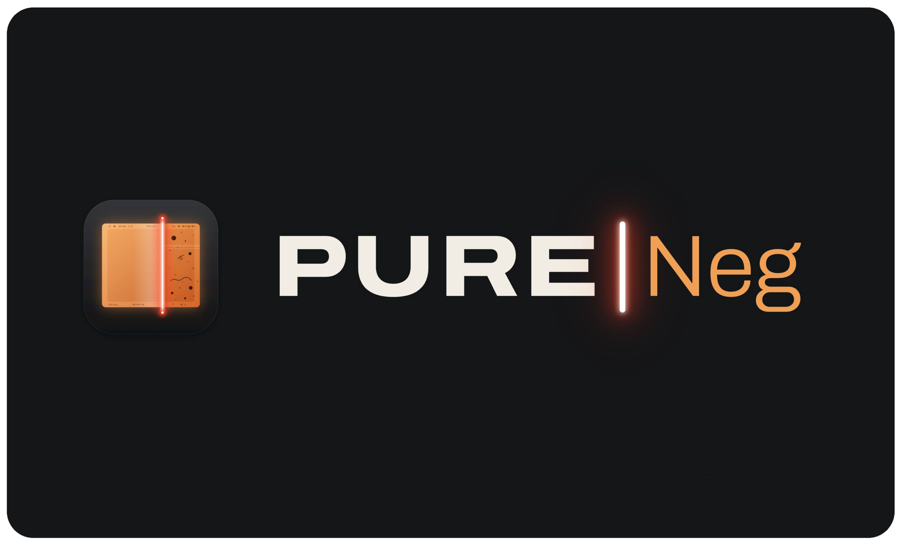
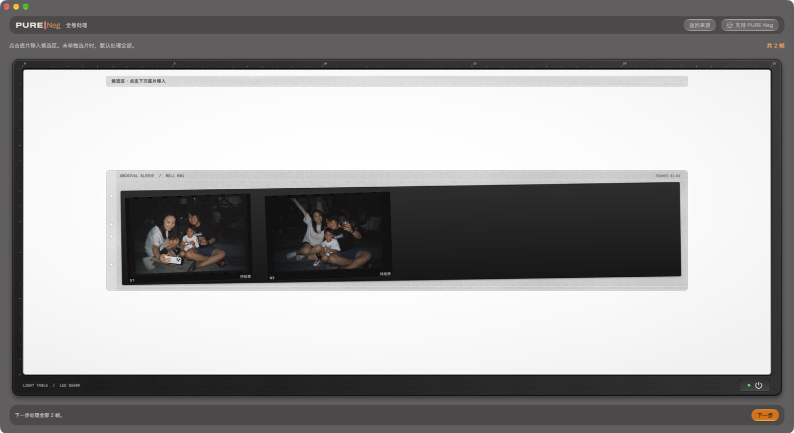
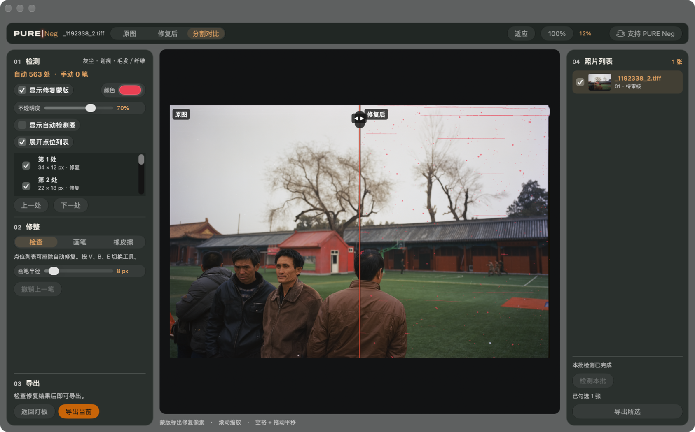

# PURE Neg

面向胶片扫描件的 macOS 除尘与修整工具。从一整卷里选出要处理的底片，检查自动标出的灰尘、划痕和纤维，再逐张修整和导出。

PURE Neg 是独立维护的 macOS 应用。除尘引擎基于 Magnus Holmes 的 MIT 开源项目。 [上游项目 film-dust](https://github.com/magholmes/film-dust) · [基准提交 `fcf68d6`](https://github.com/magholmes/film-dust/commit/fcf68d6c6a77e4373db28f878c7f80f7b8934f3f)

[下载 PURE Neg 正式版](https://github.com/easonzhangbin/PURENeg/releases/latest) · Apple 芯片 Mac，macOS 14 或更新版本。

[源码与构建](#源码与构建) · [技术内核与开源项目](#技术内核与开源项目) · [支持 PURE Neg](SUPPORT.md)

## 界面与操作

### 观片台

导入多张 TIFF 或 JPEG 后，在灯板上点选底片。底片会从袋中移到上方候选区，再点一次可放回。候选区为空时，「下一步」会纳入整卷。右下角的电源按钮可点亮灯板。关闭时指示灯为红色，开启时为绿色。支持 HDR 的屏幕会提亮透光区域，接缝和印字附近用半透明遮光保留细节。

### 除尘审核

中央画布可切换「原图」「修复后」和「分割对比」，也能缩放检查。左栏用可调颜色和不透明度的蒙版标出修复位置。用画笔补修漏点，用橡皮擦恢复误修，也可从点位列表排除整处。右栏保留原始帧号，显示检测进度和处理状态。检测中可直接点击另一张照片切换。批量处理时，默认闲置 4 秒后检测其余照片，操作时暂停。

检查修复结果后，点左下角「导出当前」。也可在右侧勾选多张照片，再点「导出所选」。支持按原始分辨率导出 TIFF、JPEG 或 PNG，保存时可选择附带修复蒙版。导出后仍可继续修整，再导出一个新版本。

## 视觉设计

观片台取自实体灯板和半透明底片袋。袋口、帧号与抽出底片的动作让整卷照片的位置一眼可辨。审核页把照片留在中央，工具和批次信息分列两侧。

控制区域使用 macOS 原生玻璃材质，照片保持在独立画布。品牌以石墨灰和暗房黑为底，片基琥珀用于主要操作和选中状态，激光红提示检测进度。修复蒙版默认使用荧光红，可按照片内容调整。

等待预览时，中央保留当前照片的模糊背景，细尘成团卷过画面，近处偶尔掠过虚焦颗粒。预览就绪后，等待画面淡入清晰的修复结果。

## 源码与构建

macOS 界面使用 AppKit 和 SwiftUI。本机检测、审核和导出逻辑使用 JavaScript，支持通过 Node-API 调用 C++ 加速内核。 [macOS 界面](macos/) · [处理流程](src/) · [除尘引擎](vendor/film-dust/) · [构建指南](docs/BUILD.md) · [macOS 构建脚本](scripts/build-macos.sh)

## 技术内核与开源项目

- **film-dust**。自动检测与修补基于 Magnus Holmes 的 MIT 项目。PURE Neg 在原始像素上补充划痕检测和纤维追踪，并实现观片台、点位审核、蒙版修整与批量导出。 [基准提交 `fcf68d6`](https://github.com/magholmes/film-dust/commit/fcf68d6c6a77e4373db28f878c7f80f7b8934f3f)
- **scikit-image**。film-dust 的骨架细化查表方法参考了该项目的实现。 [项目主页](https://scikit-image.org/)
- **Torchvision**。按 film-dust 的上游说明，其场景判断模型基于 MobileNetV3-small ImageNet 权重。 [模型文档](https://docs.pytorch.org/vision/stable/models/generated/torchvision.models.mobilenet_v3_small.html)
- **Node.js**。下载包随附本机运行环境，用于执行检测和修补引擎。 [项目主页](https://nodejs.org/)

软件源码采用 MIT 许可。图标、字标、启动画面、收款码和示例照片分别保留各自的权利与署名。 [项目许可](LICENSE) · [第三方许可说明](THIRD_PARTY_NOTICES.md) · [引擎上游声明](vendor/film-dust/NOTICES.txt)

## 安装与使用指南

从 [Releases](https://github.com/easonzhangbin/PURENeg/releases) 下载 macOS ZIP。解压后保留完整文件夹，双击「打开 PURE Neg.command」。安装包使用本地临时签名，尚未经过 Apple 公证。

应用会定期检查 GitHub 正式版，发现新版时可在提示中下载安装。可从「PURE Neg → 检查更新…」立即检查，或在「设置 → 通用」调整自动检查。

「帮助」菜单提供 GitHub 项目主页和中英文使用指南。

## 截图来源

除尘审核截图中的照片由 PURE Neg 作者拍摄。

观片台示例照片由 Jack Delano 拍摄，来自美国国会图书馆版画与摄影部 FSA/OWI 彩色摄影档案。 [铁路编组场](https://www.loc.gov/item/2017878015/) · [铁路站场](https://www.loc.gov/resource/fsac.1a34616/) · [机车车间](https://www.loc.gov/item/2017878063/) · [南水街货运站](https://www.loc.gov/item/2017878163/)

## 支持 PURE Neg

如果你愿意支持后续开发和影像研究，可以用支付宝扫码。付款前请核对收款方 **StudioPURE**。 [支持 PURE Neg](SUPPORT.md)

