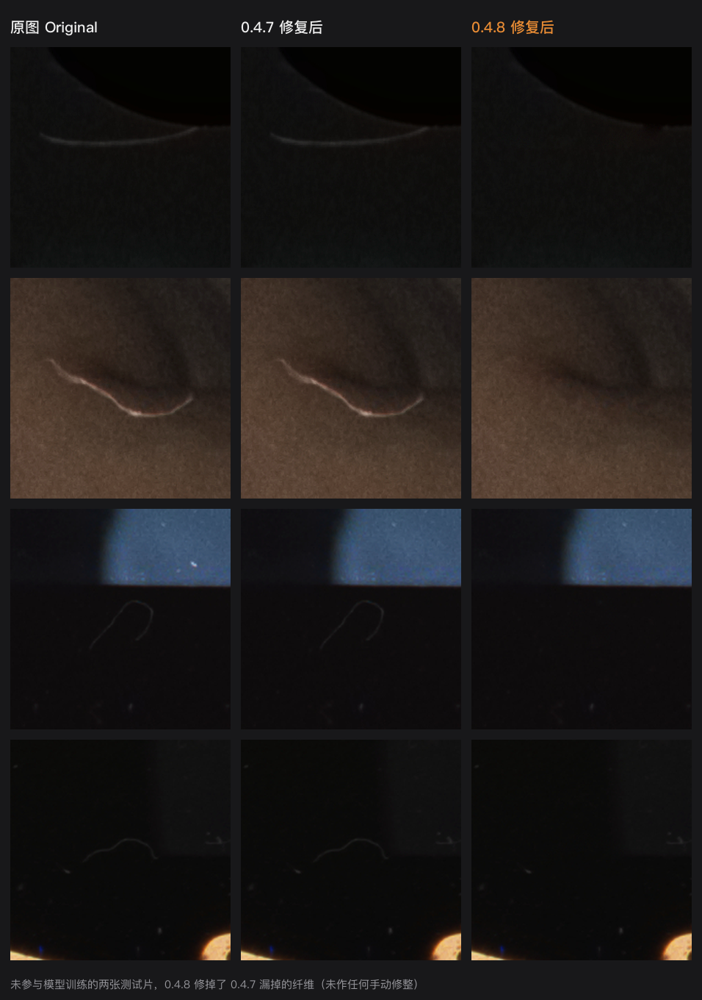
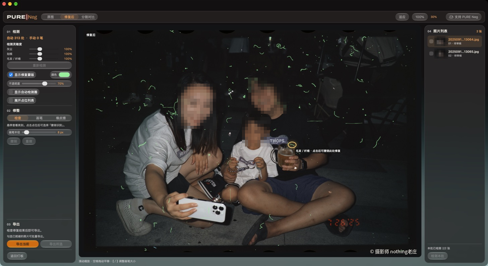
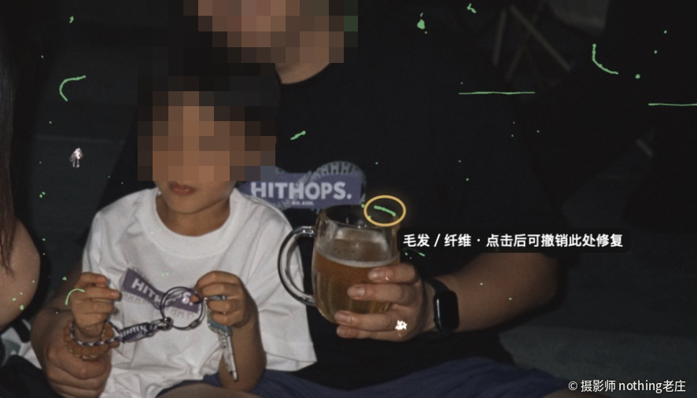
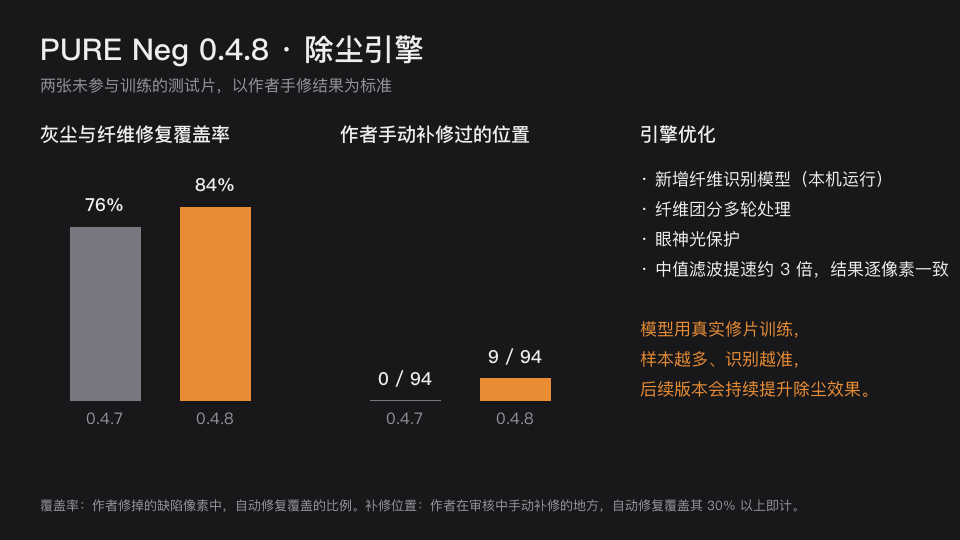

# PURE Neg

面向胶片扫描件的 macOS 除尘与修整工具。从一整卷里选出要处理的底片，检查自动标出的灰尘、划痕和纤维，再逐张修整和导出。

PURE Neg is a macOS app for cleaning up film scans. Pick frames from a roll, review automatically detected dust, scratches, and fibers, then refine and export the images.

PURE Neg 是独立维护的 macOS 应用。除尘引擎基于 Magnus Holmes 的 MIT 开源项目。

PURE Neg is independently maintained. Its repair engine is based on Magnus Holmes’s MIT-licensed project. [上游项目 / Upstream film-dust](https://github.com/magholmes/film-dust) · [基准提交 / Upstream commit `fcf68d6`](https://github.com/magholmes/film-dust/commit/fcf68d6c6a77e4373db28f878c7f80f7b8934f3f)

[下载 macOS 安装包 / Download for macOS][macos-installer] · [版本说明 / Release notes](https://github.com/easonzhangbin/PURENeg/releases/latest) · [更新记录 / Changelog](CHANGELOG.md)

Apple 芯片 Mac，macOS 14 或更新版本。 · Requires an Apple silicon Mac with macOS 14 or later.

[源码与构建 / Source and build](#源码与构建--source-and-build) · [技术内核与开源项目 / Engine and open-source credits](#技术内核与开源项目--engine-and-open-source-credits) · [支持 / Support PURE Neg](SUPPORT.md)

## 最新版本 0.4.8 · What's new in 0.4.8

- **认得更准**：新增本机运行的纤维识别模型，淡纤维、彩色背景和粗颗粒上的纤维漏得更少；纤维团分几轮处理；人像眼神光不再被误修。
- **修整更顺手**：鼠标指向修复点会出现光圈，并提示「点击后可撤销此处修复」；重新计算时画面显示「正在更新…」；分割对比自动隐藏蒙版；手动笔画上限提高到 1024 笔。
- **导出更清爽**：照片直接存进所选目录，文件名为「原文件名-PN」；修复蒙版 TIFF 默认不导出。
- **观片台更真实**：HDR 灯光更亮，片袋和托盘呈磨砂塑料质感，开关灯有咔嗒声和日光灯启辉效果。

- **Better detection**: an on-device fiber model finds faint fibers and fibers on colored or grainy ground that earlier versions missed. Tangles are cleaned in several passes, and catchlights in eyes are left alone.
- **Smoother review**: the spot under the pointer glows with a hint that clicking undoes it, an indicator shows while the preview updates, Split View hides the mask, and up to 1,024 manual strokes are allowed.
- **Cleaner export**: photos go straight into the chosen folder as `name-PN`, and the repair mask TIFF is off unless you tick it.
- **Light table**: a brighter HDR lamp, frosted sleeves, a switch click, and a fluorescent-style start-up flicker.

[完整更新记录 / Full changelog](CHANGELOG.md)

## 界面与操作 · Workflow

### 观片台 · Light Table

导入多张 TIFF 或 JPEG 后，在灯板上点选底片。底片会从袋中移到上方候选区，再点一次可放回。候选区为空时，「下一步」会纳入整卷。右下角的电源按钮可点亮灯板，开关时有咔嗒声，开灯时像日光灯一样闪几下再稳定点亮。关闭时指示灯为红色，开启时为绿色。在支持 HDR 的屏幕上，空白灯面用屏幕可长时间保持的最高亮度发光，底片袋、托盘和底片按透光比例暗一些，袋面透出柔和的磨砂塑料质感，接缝和印字保留细节。

Import a batch of TIFF or JPEG scans and click frames to move them from the film sleeve to your picks. Click a frame again to return it. If you leave the picks empty, **Next** includes the whole roll. The power button lights the table with a switch click and a fluorescent-style flicker. On HDR displays the bare lamp runs at the brightest level the screen can sustain, while sleeves, tray, and film transmit proportionally less light through a frosted look.

### 除尘审核 · Repair review

中央画布可切换「原图」「修复后」和「分割对比」，也能缩放检查。左栏用可调颜色和不透明度的蒙版标出修复位置。在检查模式把鼠标移到修复点上，修复点外圈会出现呼吸光圈，提示会写明类别和「点击后可撤销此处修复」。用画笔补修漏点，用橡皮擦恢复误修，也可从点位列表排除整处；每张最多 1024 笔。撤销、重做或修整后重新计算时，画面右上角显示「正在更新…」。进入「分割对比」时自动隐藏蒙版，离开后恢复原设置。右栏保留原始帧号，显示检测进度和处理状态。检测中可直接点击另一张照片切换。批量处理时，默认闲置 4 秒后检测其余照片，操作时暂停。

Switch between **Original**, **Repaired**, and **Split View**, and zoom in to inspect the repair mask. Hover a repair to see a glowing ring and a hint that a click undoes it. Use the brush on missed spots, the eraser to restore details, or the spot list to exclude a whole detection. An indicator shows while the preview updates, and Split View hides the mask until you leave it. The sidebar keeps the original frame numbers and shows processing progress. Batch detection starts after four seconds of inactivity by default and pauses while you work.

检查修复结果后，点左下角「导出当前」。也可在右侧勾选多张照片，再点「导出所选」。支持按原始分辨率导出 TIFF、JPEG 或 PNG。照片直接保存到所选目录，文件名为「原文件名-PN」，例如 `20250918-ECN213064-PN.jpg`；重名时自动加序号，不会覆盖。修复蒙版 TIFF 默认不导出，需要时在保存窗口勾选。导出后仍可继续修整，再导出一个新版本。

Use **Export Current** for one frame or **Export Selected** for a batch. Export TIFF, JPEG, or PNG at the original resolution, straight into the chosen folder as `name-PN` (numbered if the name is taken). The repair mask TIFF is exported only when you tick it. You can keep editing after export and save another version.

## 除尘引擎 · Repair engine

- **纤维识别模型（0.4.8 新增）**：一个用作者真实修片训练的小型神经网络，通过 Apple Core ML 在本机运行，一张 5000 万像素的扫描约 3 秒，不联网。它只告诉追踪器「这里像纤维」，修不修仍由原有规则判断，不会因此乱修画面。
- **纤维追踪**：沿断续、弯曲的纤维追到尾端；纤维团分多轮处理，先修清楚的一根，再修被它压住的交叉纤维。物体轮廓高光、台阶边缘、宽而柔和的线条不当作纤维。
- **画面保护**：用 macOS Vision 找到人像眼睛，眼神光不再被当成灰尘。
- **速度**：检测内核中最耗时的中值滤波改用常数时间算法，这一步快约 3 倍，结果逐像素一致。新增的模型和多轮处理会多花一点时间，整张处理时间与上一版相近。
- **持续训练**：模型每增加一批修好的片子就可以重新训练。后续版本会用更多胶卷和场景继续提升除尘效果，「斑块」（半透明亮片）识别在下一版。

- **Fiber model (new in 0.4.8)**: a small neural network trained on the author’s corrected scans runs on device through Apple Core ML, about 3 seconds for a 50 MP scan. It only points the tracer to likely fibers; the existing rules still decide every repair.
- **Fiber tracing** follows broken, curved fibers to their ends and takes tangles apart over several passes, while rim highlights, step edges, and soft wide lines are left alone.
- **Scene protection** uses macOS Vision to keep catchlights in eyes.
- **Speed**: the heaviest filter now runs in constant time, about 3× faster with identical output; the new model and passes add a little, so overall time is close to the previous release.
- **Ongoing training**: the model is retrained as more corrected frames come in, and soft translucent flakes are next.

## 视觉设计 · Visual design

观片台取自实体灯板和半透明底片袋。袋口、帧号与抽出底片的动作让整卷照片的位置一眼可辨。审核页把照片留在中央，工具和批次信息分列两侧。

控制区域使用 macOS 原生玻璃材质，照片保持在独立画布。品牌以石墨灰和暗房黑为底，片基琥珀用于主要操作和选中状态，激光红提示检测进度。修复蒙版默认使用荧光红，可按照片内容调整。

等待预览时，中央保留当前照片的模糊背景，细尘成团卷过画面，近处偶尔掠过虚焦颗粒。预览就绪后，等待画面淡入清晰的修复结果。

The light table borrows its sleeves and frame numbers from physical film storage. The review window puts the image in the center with tools and batch details on either side. Native macOS glass materials frame the canvas, amber marks primary actions, and the repair mask uses a configurable color. A soft preview fades into the repaired image when it’s ready.

## 源码与构建 · Source and build

macOS 界面使用 AppKit 和 SwiftUI。本机检测、审核和导出逻辑使用 JavaScript，支持通过 Node-API 调用 C++ 加速内核。

The macOS interface uses AppKit and SwiftUI. Detection, review, and export run locally in JavaScript, with optional C++ acceleration through Node-API. [界面 / macOS UI](macos/) · [处理流程 / Pipeline](src/) · [引擎 / Engine](vendor/film-dust/) · [构建指南 / Build guide](docs/BUILD.md) · [构建脚本 / Build script](scripts/build-macos.sh)

## 技术内核与开源项目 · Engine and open-source credits

- **FibreNet（PURE Neg 自有）**。纤维识别模型由 PURE Neg 用作者修过的扫描训练，随应用以 Core ML 格式分发，在本机运行。 PURE Neg’s own fiber model, trained on the author’s corrected scans and shipped as a Core ML model that runs on device.
- **film-dust**。自动检测与修补基于 Magnus Holmes 的 MIT 项目。PURE Neg 在原始像素上补充划痕检测和纤维追踪，并实现观片台、点位审核、蒙版修整与批量导出。 PURE Neg extends Magnus Holmes’s detection and repair engine with full-resolution scratch and fiber detection, a light table, spot review, mask editing, and batch export. [基准提交 / Upstream commit `fcf68d6`](https://github.com/magholmes/film-dust/commit/fcf68d6c6a77e4373db28f878c7f80f7b8934f3f)
- **scikit-image**。film-dust 的骨架细化查表方法参考了该项目的实现。 film-dust’s lookup-based skeleton thinning draws on this project. [项目主页 / Project site](https://scikit-image.org/)
- **Torchvision**。按 film-dust 的上游说明，其场景判断模型基于 MobileNetV3-small ImageNet 权重。 The upstream scene classifier uses MobileNetV3-small ImageNet weights. [模型文档 / Model documentation](https://docs.pytorch.org/vision/stable/models/generated/torchvision.models.mobilenet_v3_small.html)
- **Node.js**。下载包随附本机运行环境，用于执行检测和修补引擎。 The installer includes the local runtime for detection and repair. [项目主页 / Project site](https://nodejs.org/)

软件源码采用 MIT 许可。图标、字标、启动画面、收款码和示例照片分别保留各自的权利与署名。

The source code is MIT licensed. The artwork, payment QR code, and sample photos retain their own rights and attribution. [项目许可 / License](LICENSE) · [第三方许可 / Third-party notices](THIRD_PARTY_NOTICES.md) · [上游声明 / Upstream notices](vendor/film-dust/NOTICES.txt)

[macos-installer]: https://github.com/easonzhangbin/PURENeg/releases/download/v0.4.8/PURE-Neg-0.4.8-macos-arm64.zip

## 安装与使用指南 · Installation and help

在 Finder 双击 ZIP 解压，再双击与 `PURE Neg.app` 放在同一目录的「打开 PURE Neg.command」。安装包使用本地临时签名，尚未经过 Apple 公证。

Unzip the installer in Finder and double-click `打开 PURE Neg.command` beside `PURE Neg.app`. The installer uses an ad hoc signature and has not been notarized by Apple. [下载 macOS 安装包 / Download the macOS installer][macos-installer]

应用会定期检查 GitHub 正式版，发现新版时可在提示中下载安装。可从「PURE Neg → 检查更新…」立即检查，或在「设置 → 通用」调整自动检查。

「帮助」菜单提供 GitHub 项目主页和中英文使用指南。

The app checks GitHub for releases and verifies signatures on in-app updates. Use **PURE Neg → Check for Updates…** to check now, or **Settings → General** to manage automatic checks. The **Help** menu links to the project and the user guide in Chinese and English.

## 截图来源 · Photo credits

软件界面截图（观片台、除尘审核页与检查模式细节）中展示的照片由摄影师 **nothing老庄** 拍摄。0.4.8 对比图中的照片由 PURE Neg 作者提供。

The photos shown in the app screenshots (light table, repair review, and the inspection close-up) are by photographer **nothing老庄**. The 0.4.8 comparison uses photos provided by the PURE Neg author.

## 支持 PURE Neg · Support PURE Neg

如果你愿意支持后续开发和影像研究，可以用支付宝扫码。付款前请核对收款方 **StudioPURE**。

To support development and imaging research, scan the QR code with Alipay and confirm the recipient is **StudioPURE**. [支持详情 / Support details](SUPPORT.md)

### 捐赠者名单 · Donors

感谢以下朋友支持 PURE Neg 的开发与影像研究 · Thank you to everyone who supports PURE Neg:

- J3RRYK33PF1T
- 熊小默

以后有新的捐赠者，名单会随版本更新持续追加，并同步显示在应用「帮助 → PURE Neg 使用指南 → 捐赠者名单」中。 New donors are added with each update and also appear under **Help → PURE Neg Guide → Donors** in the app.
